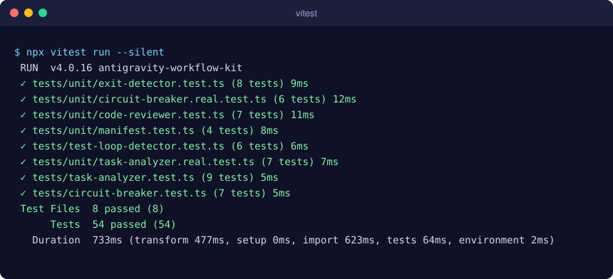
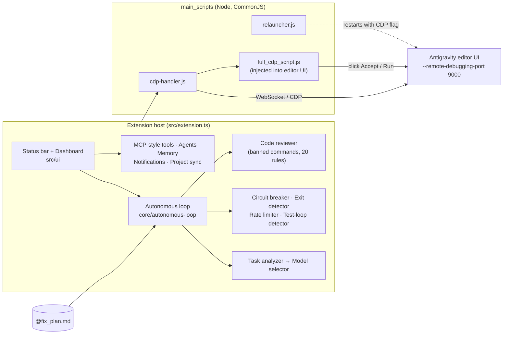

<div align="center">
  

  <p><strong>Auto-accept, autonomous loops and safety rails for the Antigravity IDE.</strong></p>

  [](LICENSE)
  [](https://github.com/muhib-karim/antigravity-workflow-kit)
  [](https://github.com/muhib-karim/antigravity-workflow-kit/actions/workflows/ci.yml)
  [](https://open-vsx.org/extension/ai-dev-2024/antigravity-workflow-kit)

  [Features](#features) • [Install](#install) • [Usage](#usage) • [Architecture](#architecture) • [Testing](#testing) • [Limitations](#limitations--roadmap)
</div>

---

## What it is

**Antigravity Workflow Kit** is a VS Code–compatible extension written in TypeScript for the
[Antigravity](https://antigravity.google/) AI editor. It connects to the editor's own UI over the
**Chrome DevTools Protocol (CDP)** and clicks the *Accept / Run* buttons on AI-proposed file edits and terminal
commands for you. Commands that match a configurable deny-list are never auto-accepted. On top of that it adds an
experimental **autonomous loop**. The loop reads the next task from a `@fix_plan.md` checklist, picks a model for
the kind of task, and stops itself through a circuit breaker and exit detector when it stops making progress.

The extension is published on Open VSX as
[`ai-dev-2024.antigravity-workflow-kit`](https://open-vsx.org/extension/ai-dev-2024/antigravity-workflow-kit).

## Features

All of these are implemented in this repository:

| Area | What it does | Where |
|------|--------------|-------|
| **Auto-All** | Detects Antigravity's CDP endpoint (ports 9000–9010) and offers to relaunch the editor with `--remote-debugging-port` if needed. Injects a script that auto-accepts edits and commands | `main_scripts/cdp-handler.js`, `main_scripts/relauncher.js`, `src/extension.ts` |
| **Banned commands** | Deny-list (`workflowKit.bannedCommands`) plus built-in destructive-pattern checks (`rm -rf /`, `dd … of=/dev/…`, `format c:` …) | `src/core/code-reviewer.ts` |
| **Multi-Tab** | Rotates across conversation tabs, with a background overlay | `main_scripts/` |
| **Autonomous loop** *(beta)* | Works through unchecked `- [ ]` items in `@fix_plan.md`, with a rate limiter (max calls/hour), per-loop timeout and max loops per session | `src/core/autonomous-loop.ts`, `rate-limiter.ts` |
| **Circuit breaker** | CLOSED → HALF_OPEN → OPEN on repeated no-progress or identical responses. Stays open until manually reset | `src/core/circuit-breaker.ts` |
| **Exit detection** | Stops on completion phrases, response stagnation or 3 consecutive failures | `src/core/exit-detector.ts`, `test-loop-detector.ts` |
| **Model routing** | Keyword-based task classification (reasoning / frontend / quick / general) mapped to configurable preferred models | `src/core/task-analyzer.ts`, `model-selector.ts` |
| **Code review** | 20 regex rules (security, quality, performance, bug patterns) with a score, surfaced as VS Code diagnostics | `src/core/code-reviewer.ts` |
| **MCP-style tools** | In-process registry of 10 tools (file read/write/list/search, terminal, workspace info, editors, diagnostics, git status/diff) | `src/providers/mcp-server.ts` |
| **Multi-agent orchestration** | 5 agent roles: researcher, implementer, reviewer, tester, planner | `src/core/agent-orchestrator.ts` |
| **Extras** | Session memory, test-file generator, Jira/GitHub issue sync, Slack/Discord/webhook notifications, voice commands (needs the VS Code Speech extension), custom model providers (Anthropic, Google, OpenAI, Ollama) | `src/core/`, `src/providers/`, `src/ui/` |
| **Dashboard** | Webview settings panel with feature toggles, model preferences and session stats | `src/ui/dashboard.ts`, `src/settings-panel.ts` |

### Demo

Background mode overlay showing progress per conversation tab (screenshot from an earlier release of the extension):


Unit test run, rendered from real terminal output:



## Install

**From Open VSX:** search for **"Antigravity Workflow Kit"** in Antigravity's Extensions view, or open the
[Open VSX page](https://open-vsx.org/extension/ai-dev-2024/antigravity-workflow-kit).

**From a VSIX:** download a `.vsix` from [GitHub Releases](https://github.com/muhib-karim/antigravity-workflow-kit/releases).
Then run `Ctrl/Cmd+Shift+P` → **Extensions: Install from VSIX…**

**From source** (Node.js 20+):

```bash
git clone https://github.com/muhib-karim/antigravity-workflow-kit.git
cd antigravity-workflow-kit
npm ci
npm run compile      # esbuild bundle -> dist/extension.js
npm run package      # produces antigravity-workflow-kit-<version>.vsix (uses docs/MARKETPLACE.md as its README)
```

## Usage

Status bar items toggle **Auto-All**, **Multi-Tab** and the **autonomous loop**. The ⚙️ item opens the dashboard.
All commands are also available from the Command Palette:

| Command | ID |
|---------|----|
| Workflow Kit: Toggle Extension ON/OFF | `workflowKit.toggleExtension` |
| Workflow Kit: Toggle Auto-All Mode | `workflowKit.toggleAutoAll` |
| Workflow Kit: Toggle Multi-Tab Mode | `workflowKit.toggleMultiTab` |
| Workflow Kit: Toggle Autonomous Loop | `workflowKit.toggleAutopilotMode` |
| Workflow Kit: Open Dashboard | `workflowKit.openSettings` |
| Workflow Kit: Toggle MCP Server | `workflowKit.toggleMcp` |
| Workflow Kit: Toggle Voice Control | `workflowKit.toggleVoice` |
| Workflow Kit: Generate Tests for Current File | `workflowKit.generateTests` |
| Workflow Kit: Run Code Review | `workflowKit.runCodeReview` |
| Workflow Kit: Start Multi-Agent Task | `workflowKit.startMultiAgent` |
| Workflow Kit: Show Session Memory | `workflowKit.showMemory` |
| Workflow Kit: Sync Project Tasks (Jira/GitHub) | `workflowKit.syncProjectTasks` |

**Autonomous loop:** put a checklist in `@fix_plan.md` at the workspace root (see the one in this repo for an
example). Then toggle the loop. Each iteration takes the first `- [ ]` item.

### Key settings

| Setting | Default | Description |
|---------|---------|-------------|
| `workflowKit.autoAllEnabled` | `false` | Auto-accept file edits and commands |
| `workflowKit.multiTabEnabled` | `false` | Work across all conversation tabs |
| `workflowKit.autopilotModeEnabled` | `false` | Autonomous loop with model selection |
| `workflowKit.bannedCommands` | `rm -rf /`, `rm -rf ~`, `format c:`, `del /f /s /q` | Never auto-executed |
| `workflowKit.maxCallsPerHour` | `100` | Rate limit for the loop |
| `workflowKit.maxLoopsPerSession` | `100` | Loop stops after this many iterations |
| `workflowKit.loopInterval` | `30` | Seconds between iterations |
| `workflowKit.preferredModelForReasoning` | `claude-opus-4.5-thinking` | Model for debugging / architecture tasks |
| `workflowKit.preferredModelForFrontend` | `gemini-3-pro-high` | Model for UI tasks |
| `workflowKit.preferredModelForQuick` | `gemini-3-flash` | Model for small tasks |

The full list is in `package.json` under `contributes.configuration`.

## Architecture



- **`src/`** is TypeScript, bundled by esbuild into `dist/extension.js`. `vscode` is kept external.
- **`main_scripts/`** holds plain JavaScript loaded at runtime with `require()`. It finds the CDP endpoint, relaunches
  the editor with the debugging flag, and injects the auto-accept script into the editor's webviews.
- Configuration is read through a typed singleton (`src/utils/config.ts`) backed by `DEFAULT_CONFIG` in
  `src/utils/constants.ts`.

## Testing

```bash
npm ci
npm run lint        # ESLint (typescript-eslint recommended; style rules reported as warnings)
npm run typecheck   # tsc --noEmit, strict mode
npm test            # vitest: 54 tests in 8 files
npm run compile     # esbuild bundle
```

Tests live in `tests/`. A small mock of the `vscode` API is in `tests/mocks/vscode.ts`.

- `tests/unit/*.test.ts` import the real modules from `src/`: circuit breaker state machine, exit detector,
  task analyzer and model selector, code reviewer and banned-command checks. One manifest test checks that every
  command in `package.json` is registered in `src/extension.ts`, that setting defaults match `DEFAULT_CONFIG`, and
  that every selectable model ID has a display label.
- `tests/*.test.ts` are older specification-style tests that model the intended behaviour inline.

CI (`.github/workflows/ci.yml`) runs lint, type check, tests, build and VSIX packaging on Node 20 and 22 for every
push and pull request to `master`.

## Project structure

```
├── src/
│   ├── extension.ts          # activation, command registration, CDP wiring
│   ├── settings-panel.ts     # settings webview
│   ├── core/                 # loop, circuit breaker, exit/test-loop detection, rate limiting,
│   │                         # task analysis, model selection, code review, agents, memory, test generator
│   ├── providers/            # CDP client, MCP-style tools, model providers, usage scraping, Jira/GitHub sync
│   ├── ui/                   # dashboard, status bar, styles, voice controller
│   └── utils/                # config, constants, logger
├── main_scripts/             # runtime CDP handler, relauncher, injected auto-accept scripts
├── tests/                    # vitest suites + vscode mock
├── media/                    # icon and screenshots
├── docs/                     # banner, README assets, MARKETPLACE.md (README packaged into the VSIX)
├── out/, extension.js        # legacy build output from earlier versions (not used by package.json "main")
└── .github/workflows/        # ci.yml, ci-cd.yml, release.yml
```

## Limitations & roadmap

- **Depends on Antigravity's internal UI.** Auto-accept works by finding buttons in the editor's DOM over CDP, so
  Antigravity UI updates can break it. It also requires the editor to run with a remote-debugging port, which the
  extension offers to set up by relaunching.
- **The autonomous loop is beta.**
- **Use auto-accept with care.** The banned-command list is a safety net, not a sandbox. Review what the AI is
  allowed to run.
- Many advanced modules (memory, agents, project sync, voice, notifications) have no automated tests yet. Next
  steps: extend unit coverage to `rate-limiter`, `recovery-strategies` and `memory-manager`, convert the older
  specification-style tests to import the real modules, and remove the legacy `out/` build output.

## Contributing

See [CONTRIBUTING.md](CONTRIBUTING.md). Please run `npm run lint && npm run typecheck && npm test` before opening a PR.

## License

[MIT](LICENSE)

---

<div align="center">
  <a href="https://ko-fi.com/ai_dev_2024">
    
  </a>
</div>
