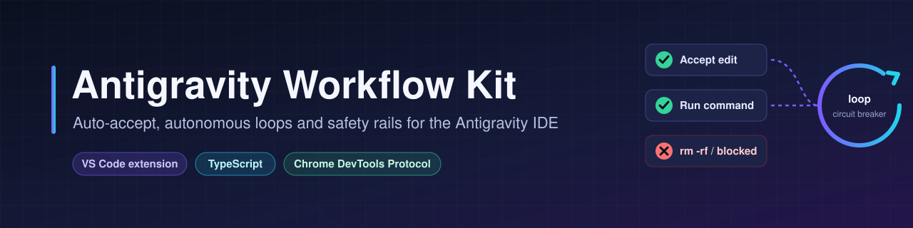
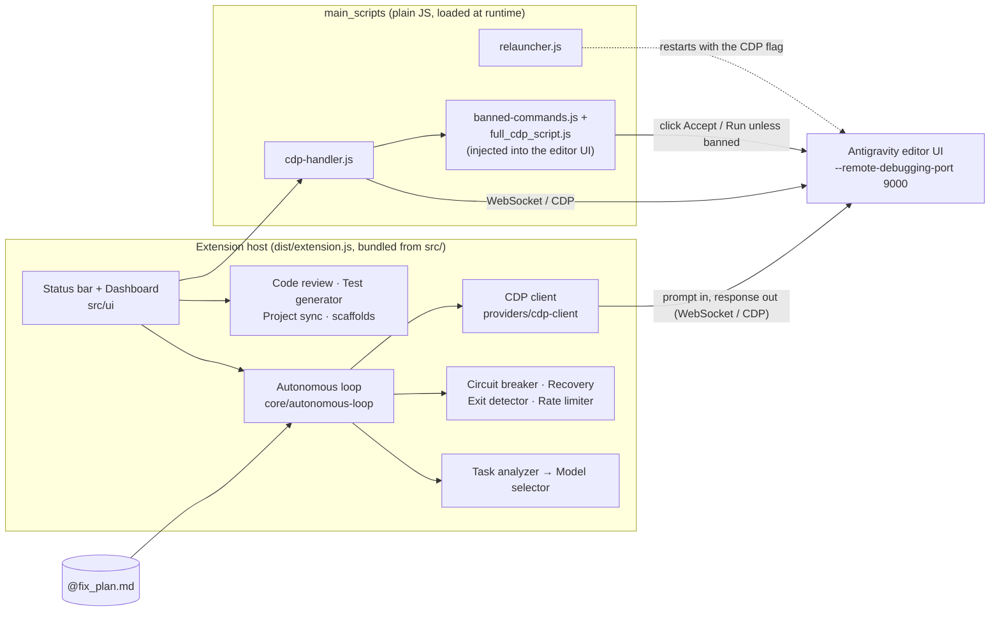

<div align="center">
  

  <p><strong>Auto-accept, autonomous loops and safety rails for the Antigravity IDE.</strong></p>

  [](LICENSE)
  [](https://github.com/muhib-karim/antigravity-workflow-kit)
  [](https://github.com/muhib-karim/antigravity-workflow-kit/actions/workflows/ci.yml)
  [](https://open-vsx.org/extension/ai-dev-2024/antigravity-workflow-kit)

  [Quickstart](#quickstart) • [Features](#features) • [Safety model](#safety-model) • [Usage](#usage) • [Architecture](#architecture) • [Development](#development) • [Limitations](#limitations)
</div>

---

## What it is

**Antigravity Workflow Kit** is a VS Code–compatible extension written in TypeScript for the
[Antigravity](https://antigravity.google/) AI editor. It connects to the editor's own UI over the
**Chrome DevTools Protocol (CDP)** and clicks the approval buttons (*Accept*, *Run*, *Apply*, …) on AI-proposed
file edits and terminal commands for you. An approval whose command matches a deny-list is left for you to click.
On top of that it adds an experimental **autonomous loop**: it sends the next unchecked item of a `@fix_plan.md`
checklist to the chat, waits for the response, and stops itself through a circuit breaker and an exit detector
when it stops making progress.

The extension is published on Open VSX as
[`ai-dev-2024.antigravity-workflow-kit`](https://open-vsx.org/extension/ai-dev-2024/antigravity-workflow-kit).

## Quickstart

1. **Install.** Search for **"Antigravity Workflow Kit"** in Antigravity's Extensions view, or open the
   [Open VSX page](https://open-vsx.org/extension/ai-dev-2024/antigravity-workflow-kit). A `.vsix` from
   [GitHub Releases](https://github.com/muhib-karim/antigravity-workflow-kit/releases) can be installed with
   `Ctrl/Cmd+Shift+P` → **Extensions: Install from VSIX…**
2. **Turn it on.** Click **Workflow Kit: OFF** in the status bar (or run *Workflow Kit: Toggle Extension ON/OFF*).
   Auto-accept needs the editor to run with a remote-debugging port. If it does not, the extension offers
   **Setup & Restart**, which adds `--remote-debugging-port=9000` to your Antigravity shortcut and relaunches it.
   Read the [safety model](#safety-model) before you accept.
3. **Check the deny-list.** Review `workflowKit.bannedCommands` in Settings and add what you never want auto-run.
4. **Optional: the autonomous loop (beta).** Put a checklist in `@fix_plan.md` at the workspace root (the one in
   this repository is an example) and run *Workflow Kit: Toggle Autonomous Loop*.

From source you need **Node.js 22.12 or newer**:

```bash
git clone https://github.com/muhib-karim/antigravity-workflow-kit.git
cd antigravity-workflow-kit
npm ci
npm run compile      # esbuild bundle -> dist/extension.js
npm run package      # antigravity-workflow-kit-<version>.vsix (uses docs/MARKETPLACE.md as its README)
```

## Features

| Area | What it does | Where |
|------|--------------|-------|
| **Auto-All** | Finds Antigravity's CDP endpoint on ports 9000–9010, offers to relaunch the editor with `--remote-debugging-port` if there is none, and injects a script that clicks approval buttons | `main_scripts/cdp-handler.js`, `main_scripts/relauncher.js`, `main_scripts/full_cdp_script.js`, `src/extension.ts` |
| **Banned commands** | Deny-list (`workflowKit.bannedCommands`) plus built-in destructive patterns, checked before any approval button is clicked. See [Safety model](#safety-model) | `main_scripts/banned-commands.js` (also used by `src/core/code-reviewer.ts`) |
| **Multi-Tab** | Rotates across conversation tabs, with a background overlay | `main_scripts/full_cdp_script.js` |
| **Autonomous loop** *(beta)* | Sends the first unchecked `- [ ]` item of `@fix_plan.md` (or a goal) to the chat each iteration, with a call limit per hour, a per-loop timeout and a maximum number of loops | `src/core/autonomous-loop.ts`, `rate-limiter.ts`, `src/providers/cdp-client.ts` |
| **Circuit breaker** | CLOSED → HALF_OPEN → OPEN after 3 loops without workspace changes, 5 consecutive errors or 5 repeated responses. The loop then tries up to 3 recovery strategies, resetting the breaker each time, and stops when they are used up | `src/core/circuit-breaker.ts`, `recovery-strategies.ts` |
| **Exit detection** | Stops on completion phrases, a response repeated 3 times, 3 consecutive failures, or several test-only loops in a row | `src/core/exit-detector.ts`, `test-loop-detector.ts` |
| **Model routing** | Keyword-based task classification (reasoning / frontend / quick / general) mapped to configurable preferred models. When the choice changes, the loop tries to select it in the editor's model picker and only announces a switch that worked | `src/core/task-analyzer.ts`, `model-selector.ts`, `src/providers/cdp-client.ts` |
| **Code review** | 20 regex rules (security, quality, performance, bug patterns) with a score, shown as diagnostics for the current file | `src/core/code-reviewer.ts` |
| **Test generator** | Writes a test-file skeleton for the current file | `src/core/test-generator.ts` |
| **Project sync** | Adds open GitHub issues or Jira tickets to the tasks already in `@fix_plan.md` (configured in `.workflow-kit/project-manager.json`). The file is rewritten as a plain checklist, and left untouched if a fetch fails | `src/providers/project-manager.ts` |
| **Dashboard** | Webview with the main toggles, model preferences, loop settings and session stats | `src/ui/dashboard.ts` |

**Scaffolds, not features yet.** These modules exist and have commands or dashboard switches (which only store a
setting), but nothing connects them to the agent or the loop: the MCP-style tool registry (`src/providers/mcp-server.ts`, in-process only), the
multi-agent orchestrator (`src/core/agent-orchestrator.ts`, task execution is a placeholder), voice commands
(`src/ui/voice-controller.ts`, a command parser without speech input), notifications
(`src/core/notification-manager.ts`), session memory (`src/core/memory-manager.ts`) and the custom model
providers (`src/providers/model-provider.ts`).

Background mode overlay showing progress per conversation tab (screenshot from an earlier release):


## Safety model

Auto-accept means the AI's edits and terminal commands run without you reading them first. The deny-list is a
safety net, not a sandbox.

**What is checked.** Before clicking any approval button, the injected script reads the code block next to it and
skips the button when the text matches:

- an entry of `workflowKit.bannedCommands`. Entries match regardless of case, whitespace and quoting, anywhere in
  the text, so the default `rm -rf /` also stops `sudo rm  -rf "/tmp/x"`. An entry written as `/pattern/flags` is
  a regular expression;
- a built-in destructive pattern, which applies whatever the list contains: recursive `rm` of an absolute or home
  path in any flag spelling or order (`rm -fr /`, `rm -r -f ~`, `rm --recursive --force $HOME`), `dd` writing to
  `/dev/…`, `format X:`, `del` with `/s`, `/f` or `/q`, and redirects to a block device.

A skipped button stays on screen for you to decide. That includes a file edit whose code block contains a banned
string.

**What is not.**

- If no command text can be found next to a *Run* button (for example after an Antigravity UI change), the button
  **is still clicked**. This is logged and counted as `unverified` in the auto-accept stats.
- The matcher only sees the text shown in the editor. It cannot see through aliases, scripts, `eval`, encoded
  payloads or a destructive command it has no pattern for.
- Buttons are recognised by their label (`accept`, `run`, `retry`, `apply`, `execute`, `confirm`, `allow`), in
  every page the debugging port exposes on ports 9000–9010.
- The remote-debugging port is unauthenticated: while it is open, any local process can drive the editor.
  **Setup & Restart** changes your Antigravity shortcut so the port stays enabled on later launches.

**Turning it off.** *Workflow Kit: OFF* tells every page to stop and closes the connections. The clicking itself
runs inside the editor page, so the extension also signals it every 5 seconds; a page that hears nothing for 20
seconds (for example because the extension host crashed) stops clicking on its own.

See [SECURITY.md](SECURITY.md) for how to report a vulnerability and for the full list of things to know.

## Usage

The status bar has one **Workflow Kit: ON/OFF** item, which toggles auto-accept and shows the loop counter while
the autonomous loop runs, and a ⚙️ item that opens the dashboard. Everything is also in the Command Palette:

| Command | ID |
|---------|----|
| Workflow Kit: Toggle Extension ON/OFF | `workflowKit.toggleExtension` |
| Workflow Kit: Toggle Auto-All Mode | `workflowKit.toggleAutoAll` |
| Workflow Kit: Toggle Multi-Tab Mode | `workflowKit.toggleMultiTab` |
| Workflow Kit: Toggle Autonomous Loop | `workflowKit.toggleAutopilotMode` |
| Workflow Kit: Open Dashboard | `workflowKit.openSettings` |
| Workflow Kit: Run Code Review | `workflowKit.runCodeReview` |
| Workflow Kit: Generate Tests for Current File | `workflowKit.generateTests` |
| Workflow Kit: Sync Project Tasks (Jira/GitHub) | `workflowKit.syncProjectTasks` |
| Workflow Kit: Show Session Memory | `workflowKit.showMemory` |
| Workflow Kit: Toggle MCP Server *(scaffold)* | `workflowKit.toggleMcp` |
| Workflow Kit: Toggle Voice Control *(scaffold)* | `workflowKit.toggleVoice` |
| Workflow Kit: Start Multi-Agent Task *(scaffold)* | `workflowKit.startMultiAgent` |

**Autonomous loop.** Each iteration takes the first `- [ ]` item of `@fix_plan.md` and sends it as a prompt. The
loop does not tick items itself; the model is expected to check the box when the task is done. With no
`@fix_plan.md` and no goal, the loop stops immediately.

### Key settings

| Setting | Default | Description |
|---------|---------|-------------|
| `workflowKit.autoAllEnabled` | `false` | Auto-accept file edits and commands |
| `workflowKit.multiTabEnabled` | `false` | Work across all conversation tabs |
| `workflowKit.bannedCommands` | `rm -rf /`, `rm -rf ~`, `format c:`, `del /f /s /q` | Never auto-accepted (see [Safety model](#safety-model)) |
| `workflowKit.pollFrequency` | `1000` | Auto-accept polling interval in ms |
| `workflowKit.autopilotModeEnabled` | `false` | Autonomous loop |
| `workflowKit.maxLoopsPerSession` | `100` | The loop stops after this many iterations |
| `workflowKit.loopInterval` | `30` | Seconds between iterations |
| `workflowKit.maxCallsPerHour` | `100` | Prompts per hour before the loop asks whether to wait |
| `workflowKit.executionTimeout` | `15` | Minutes to wait for one response |
| `workflowKit.maxConsecutiveTestLoops` | `3` | Stop after this many test-only responses in a row |
| `workflowKit.autoGitCommit` | `false` | `git add -A && git commit` every 10 loops |
| `workflowKit.autoSwitchModels` | `true` | Classify each task and pick a preferred model |
| `workflowKit.preferredModelForReasoning` | `claude-opus-4.5-thinking` | Model for debugging / architecture tasks |
| `workflowKit.preferredModelForFrontend` | `gemini-3-pro-high` | Model for UI tasks |
| `workflowKit.preferredModelForQuick` | `gemini-3-flash` | Model for small tasks |

The full list is in `package.json` under `contributes.configuration`.

## Architecture



- **`src/`** is TypeScript, bundled by esbuild into `dist/extension.js`. `vscode` is kept external.
- **`main_scripts/`** holds plain JavaScript that the extension loads with `require()` at runtime:
  `cdp-handler.js` (finds the CDP endpoint, connects with [`ws`](https://github.com/websockets/ws), injects the
  auto-accept script), `relauncher.js` (restarts the editor with the debugging flag) and `banned-commands.js`
  (the deny-list matcher). The VSIX therefore ships `main_scripts/` and `node_modules/ws/` next to the bundle;
  `.vscodeignore` is an allow-list and `tests/unit/packaging.test.ts` checks the result.
- There are two CDP connections, both on ports 9000–9010: `cdp-handler.js` for auto-accept, and
  `src/providers/cdp-client.ts` for the autonomous loop, which types the prompt into the chat and reads the last
  response. The loop's connection is closed whenever the loop stops.
- Configuration is read through a typed singleton (`src/utils/config.ts`) backed by `DEFAULT_CONFIG` in
  `src/utils/constants.ts`.

## Development

Requires Node.js 22.12 or newer (the test runner and `vsce` need it).

```bash
npm ci
npm run lint            # ESLint (typescript-eslint recommended)
npm run typecheck       # tsc --noEmit, strict mode
npm test                # vitest
npm run test:coverage   # vitest with a v8 coverage report
npm run compile         # esbuild bundle
npm run package         # VSIX
```

Tests live in `tests/`:

- `tests/unit/*.test.ts` run the real modules. The autonomous loop is driven end to end with a mocked editor and
  a mocked `git`; the injected auto-accept script runs in a `vm` context with a small fake DOM; the packaging test
  inspects what `vsce` would put in the VSIX; the manifest test keeps `package.json`, `src/extension.ts` and
  `DEFAULT_CONFIG` in step.
- `tests/mocks/vscode.ts` is a stateful mock of the `vscode` API. Like VS Code, it rejects updates to settings
  that `package.json` does not declare.
- `tests/*.test.ts` are older specification-style tests that model the intended behaviour inline rather than
  importing `src/`.

CI (`.github/workflows/ci.yml`) runs lint, type check, tests with coverage, build, packaging, a smoke test that
loads the CDP handler from the built VSIX and a production-dependency audit on Node 22 and 24, plus a gitleaks
scan, for every push to `master` and every pull request. `release.yml` runs the same gates when a `v*` tag is
pushed, then creates the GitHub Release and publishes.

## Project structure

```
├── src/
│   ├── extension.ts          # activation, command registration, CDP wiring
│   ├── core/                 # loop, circuit breaker, recovery, exit/test-loop detection, rate limiting,
│   │                         # task analysis, model selection, code review, test generator, scaffolds
│   ├── providers/            # CDP client, project sync, usage meters, scaffolds
│   ├── ui/                   # dashboard, status bar, styles, voice scaffold
│   └── utils/                # config, constants, logger
├── main_scripts/             # runtime CDP handler, relauncher, deny-list matcher, injected auto-accept script
├── tests/                    # vitest suites + vscode mock
├── media/                    # icon and screenshots
├── docs/                     # banner, MARKETPLACE.md (the README packaged into the VSIX)
├── out/, extension.js        # legacy build output from earlier versions (not used, not packaged)
└── .github/                  # ci.yml, release.yml, dependabot.yml
```

## Limitations

- **Depends on Antigravity's internal UI.** Buttons, the chat input and responses are found through DOM selectors
  over CDP, so an Antigravity update can break auto-accept or the autonomous loop without warning.
- **The autonomous loop is beta.** It measures progress by comparing the git state of the workspace between
  loops (new commits, changed or new files), so it needs a git repository; without one every loop counts as no
  progress and the circuit breaker stops the session.
- **Use auto-accept with care.** See the [safety model](#safety-model).
- **Usage meters in the dashboard are Windows-only**; they are read from the local Antigravity language server
  with `wmic` and `netstat`.
- The scaffold modules listed under [Features](#features) have no automated tests and are not connected to the
  agent.

## Contributing

See [CONTRIBUTING.md](CONTRIBUTING.md). Please run `npm run lint && npm run typecheck && npm test` before opening
a PR, and add a regression test with every fix.

## Security

See [SECURITY.md](SECURITY.md).

## Tech stack

- **Language:** TypeScript, plus plain JavaScript for the injected and runtime-loaded scripts
- **Tools:** esbuild, Vitest, ESLint, WebSocket (`ws`)
- **CI:** GitHub Actions

## License

[MIT](LICENSE)

---

<div align="center">
  <a href="https://ko-fi.com/ai_dev_2024">
    
  </a>
</div>
